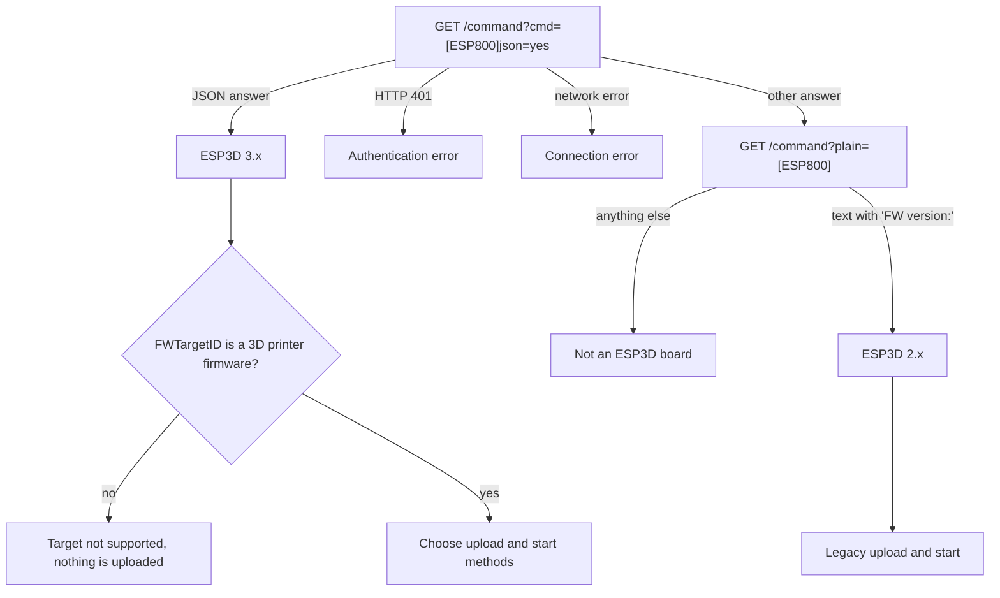

# ESP3D Print Host

## Why it exists

[ESP3D](https://github.com/luc-github/ESP3D) is firmware for ESP8266 and ESP32 boards that
gives a 3D printer a Wi-Fi connection and a web interface. Many printers ship with such a board.
The ESP3D print host lets OrcaSlicer send a sliced file to the printer over the network, and
start the print, with **Upload** or **Upload and Print**.

ESP3D boards differ a lot from one another. The same firmware can be built:

- with or without an SD card, and with that card wired to the ESP only (*direct*) or shared
  with the printer board (*shared*);
- with the MKS serial protocol of MKS boards, where files are relayed to the printer storage;
- for different printer firmwares (Marlin, Smoothieware, Repetier, or a CNC firmware);
- with or without authentication.

ESP3D 2.x and ESP3D 3.x also have different HTTP APIs. Many printer makers still ship 2.x.

A single fixed sequence of requests cannot work on all of these boards. The print host therefore
asks the board what it is, and chooses the upload and start method from the answer. No setting
is needed for that: the user enters the board address, and a user and password when the board
asks for one.

## What the user sees

The print host is set in the printer settings, in the **Connection** section (**Host Type** =
`ESP3D`).

| Field | Meaning |
| --- | --- |
| Hostname, IP or URL | Address of the ESP3D board, with or without `http://`, for example `192.168.1.50` or `esp3d.local` |
| User | ESP3D user, `admin` or `user`. Empty means `admin`. Used only when a password is set |
| Password | ESP3D password. Leave empty when authentication is disabled on the board |

**Test** checks the connection and reports what was found:

| Board | Test result |
| --- | --- |
| ESP3D 3.x, supported target, with storage | "Connection to ESP3D is working correctly." |
| ESP3D 2.x | "Connected to ESP3D *version* (2.x, legacy mode)." |
| ESP3D 3.x without SD card and without MKS protocol | Fails: the board has no storage OrcaSlicer can upload to |
| ESP3D 3.x for a firmware that is not a 3D printer firmware | Fails: "ESP3D target not supported: *target*" |
| Authentication enabled, no password set | Fails: asks for the user and password |
| Authentication enabled, wrong password | Fails: the user or password was rejected |

**Upload** stores the file on the printer side. **Upload and Print** also starts the print.

The file name is always converted to an **8.3 name**: up to 8 characters, a dot, and up to 3
characters, in upper case. Characters that a FAT file system does not accept become `_`, so
`Benchy v2.gcode` is stored as `BENCHY_V.GCO`. Printer firmwares often fail on long names, and
the same name must be used for the upload and for the start command. A file with the same 8.3
name on the card is replaced. The folder chosen in the upload dialog is not used: files go to
the root of the card.

## How it works

Every **Test** and every upload starts with a detection step. The print host then picks an
upload method and a start method. All requests are plain HTTP to the board, with HTTP basic
authentication when a password is set.



### Detection

`[ESP800]` is the ESP3D command that reports the board capabilities.

ESP3D 3.x reads commands from the `cmd` argument of `/command` and answers `[ESP800]json=yes`
with JSON. The fields used are:

| Field | Values | Used for |
| --- | --- | --- |
| `FWVersion` | e.g. `3.1.3` | Messages and logs |
| `FWTargetID` | `20` Marlin, `30` Marlin embedded (ESP3DLib), `40` Smoothieware, `50` Repetier; any other value is not supported | Target check |
| `SDConnection` | `direct`, `shared`, `none` | Upload and start method |
| `SerialProtocol` | `Raw`, `MKS`, `Socket` | MKS upload |
| `Authentication` | `Enabled`, `Disabled` | Logs |

ESP3D 2.x reads commands from the `plain` argument and answers `[ESP800]` with one line of text,
for example:

```text
FW version:2.1.2 # FW target:marlin # FW HW:Direct SD # primary sd:/ext/ # secondary sd:/sd/ # authentication: no
```

The 3.x request is sent first. ESP3D 3.x answers a guest with HTTP 401, so a 401 always means
that a 3.x board needs credentials. A network error stops the detection. Any other answer, such
as the text or HTTP error that ESP3D 2.x returns for an unknown argument, leads to the 2.x
request.

### Choosing the methods

| Board | Upload | Start ("Upload and Print") |
| --- | --- | --- |
| ESP3D 2.x | `POST /upload_serial` | `M23 <name>`, then `M24` |
| ESP3D 3.x, `SerialProtocol` = `MKS` | `POST /upload` | `M23 <name>`, then `M24` |
| ESP3D 3.x, `SDConnection` = `shared` (ESP3DLib included) | `POST /sdfiles` | `M21`, then `M23 <name>`, then `M24` |
| ESP3D 3.x, `SDConnection` = `direct` | `POST /sdfiles` | `[ESP700]/SD/<name>` |
| ESP3D 3.x, `SDConnection` = `none`, not MKS | none: error | none |
| ESP3D 3.x, target that is not a 3D printer firmware | none: error before any upload | none |

Commands are sent with `GET /command?cmd=<command>` on 3.x and `GET /command?plain=<command>`
on 2.x.

- **Shared SD card.** The ESP takes the card for the upload and gives it back to the printer
  board afterwards. `M21` makes the printer mount the card again, so that it sees the new file
  before `M23` selects it.
- **Direct SD card.** Only the ESP can read the card, so the printer cannot open the file.
  `[ESP700]` asks ESP3D to stream the file to the printer. The `/SD` prefix selects the SD card
  instead of the ESP flash file system.
- **MKS boards.** ESP3D relays the file to the printer storage in MKS protocol frames. The
  printer then prints it from its own storage with `M23` and `M24`.

The print host waits 1.5 s after the upload before it sends the start commands, and 1.5 s more
after `M21`. Printer firmwares may not answer right after a transfer, and a shared card needs
time to be mounted again.

### Upload requests

All uploads are `multipart/form-data`. The size fields let ESP3D check the free space before it
writes the file, and check the written size afterwards.

| Upload | URL | Form fields, in order |
| --- | --- | --- |
| 2.x | `/upload_serial` | `file` = the file, named `<name>` |
| 3.x SD | `/sdfiles?quiet=yes` | `path` = `/`, `/<name>S` = size in bytes, `myfile` = the file, named `/<name>` |
| 3.x MKS | `/upload` | `s<name>` = size in bytes, `myfile` = the file, named `<name>` |

`/sdfiles` reports a failed upload with HTTP 200 and a JSON body. With `quiet=yes` the body is
`{"status":"ok"}` on success; any other status is shown to the user as an upload error.

### Answers that are checked

| Request | Success when |
| --- | --- |
| Detection, 3.x | HTTP 2xx and a JSON object with `"cmd":"800"` |
| Detection, 2.x | HTTP 2xx and a body that contains `FW version:` |
| Upload `/sdfiles` | HTTP 2xx and `"status":"ok"` |
| Upload `/upload`, `/upload_serial` | HTTP 2xx |
| `M21`, `M23`, `M24` | HTTP 2xx. ESP3D forwards G-code to the printer and does not return the printer answer |
| `[ESP700] ... json=yes` | HTTP 2xx and `"status":"ok"` |

## Limits

- Only 3D printer firmwares are supported. Other targets are refused before any upload.
- Files always go to the root of the SD card, or of the printer storage on MKS boards, under an
  8.3 name. An existing file with the same name is replaced.
- On MKS boards the upload targets the SD card. USB storage is not selected.
- ESP3D 2.x keeps the 2.x sequence: `/upload_serial`, then `M23` and `M24`.
- Starting a print on a board with a direct SD card depends on the ESP3D G-code streaming
  (`[ESP700]`). It is not available when ESP3D is built without it.

## Code

- `src/slic3r/Utils/ESP3D.hpp`, `ESP3D.cpp`: detection, method choice, uploads and start
  commands.
- `src/slic3r/GUI/PhysicalPrinterDialog.cpp`: shows the user and password fields for the ESP3D
  host type.
- ESP3D sources for reference: `[ESP800]` in `esp3d/src/core/commands/ESP800.cpp`, `[ESP700]` in
  `ESP700.cpp`, HTTP handlers in `esp3d/src/modules/http/`.
